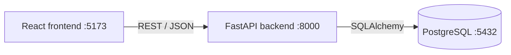

# Product Catalog Manager


A full stack web application to manage products (Create, Read, Update, Delete),
built with **React**, **FastAPI** and **PostgreSQL**, and developed entirely in **WSL2 Ubuntu**.

## Features

- Add, list, view, edit and delete products
- Search by name or description (case-insensitive)
- Client-side and server-side validation with clear error messages
- REST API documented automatically (Swagger / OpenAPI)
- Automated tests (pytest) and CI with GitHub Actions
- One-command startup with Docker Compose

## Tech stack

| Layer    | Technology                             |
|----------|----------------------------------------|
| Frontend | React 18, Vite                         |
| Backend  | FastAPI, SQLAlchemy, Pydantic v2       |
| Database | PostgreSQL 16                          |
| DevOps   | Docker, Docker Compose, GitHub Actions |

## Architecture



## Project structure

```
.
├── backend/              FastAPI application
│   ├── main.py           Routes (CRUD + search)
│   ├── models.py         SQLAlchemy models
│   ├── schemas.py        Pydantic schemas and validation
│   ├── database.py       Database connection
│   ├── tests/            pytest suite
│   └── Dockerfile
├── frontend/             React application (Vite)
│   ├── src/
│   └── Dockerfile
├── docs/screenshots/     Screenshots
├── docker-compose.yml
└── .github/workflows/    CI pipeline
```

## Quick start with Docker

```bash
git clone https://github.com/Adem-Berrabia/product-catalog-manager.git
cd product-catalog-manager
docker compose up --build
```

- Frontend: http://localhost:5173
- API docs (Swagger): http://localhost:8000/docs

Stop with `docker compose down` (add `-v` to also delete the database volume).

## Run locally (without Docker)

**Database**

```bash
sudo service postgresql start
sudo -u postgres psql -c "CREATE USER produits_user WITH PASSWORD 'produits_pwd';"
sudo -u postgres psql -c "CREATE DATABASE produits_db OWNER produits_user;"
```

**Backend**

```bash
cd backend
python3 -m venv venv && source venv/bin/activate
pip install -r requirements.txt
uvicorn main:app --reload --port 8000
```

**Frontend**

```bash
cd frontend
npm install
npm run dev
```

## API

| Method | Endpoint                | Description                         |
|--------|-------------------------|-------------------------------------|
| POST   | `/products`             | Create a product                    |
| GET    | `/products`             | List products                       |
| GET    | `/products?search=term` | Search by name or description       |
| GET    | `/products/{id}`        | Get a product                       |
| PUT    | `/products/{id}`        | Update a product                    |
| DELETE | `/products/{id}`        | Delete a product                    |

Validation: `name` is required (max 100 characters), `price >= 0`, `quantity >= 0`.
Invalid input returns `422` with details.

## Tests

```bash
cd backend
pip install -r requirements-dev.txt
pytest -v
```

The tests use an in-memory-style SQLite database, so PostgreSQL is not needed.
A quick end-to-end check against a running API is also available: `./backend/test_api.sh`.

## Configuration

Copy `.env.example` to `.env` to change the database credentials used by Docker Compose.

## Screenshots

Add your screenshots to `docs/screenshots/` and reference them here:

```md


```

## License

MIT, see [LICENSE](LICENSE).
